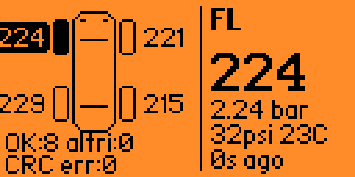
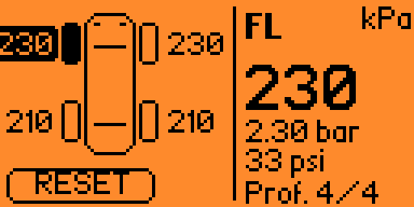

# Flipper-Zero-Nissan-TPMS-Dashboard

------ RECEIVER ------

------ TRANSMITTER ------

Flipper Zero app for pairing receiving and transmitting TPMS sensors data on Nissan cars.
 
TESTED WITH MOMENTUM DEV FW

TESTED CAR 
NISSAN XTRAIL 2019

# Nissan TPMS Dashboard for Flipper Zero

An all-in-one TPMS (Tire Pressure Monitoring System) application for Flipper Zero designed for Nissan and Renault sub-GHz TPMS sensors operating at **433.92 MHz**.

This tool allows you to monitor tire pressure and temperature in real-time, transmit TPMS signals with customizable pressure levels, pair new sensors automatically, and manage profiles for multiple vehicles.

---

## Key Features

* **TPMS RX (Receiver):** Listens on 433.92 MHz and displays real-time tire pressure and temperature for all 4 wheels. The RGB LED flashes with changing colors upon receiving valid telemetry frames.

* **TPMS TX (Transmitter):** Transmits TPMS data frames with custom pressure values for individual wheels or all 4 wheels simultaneously.

* **TPMS PAIR (Auto-Pairing):** Sniffs surrounding TPMS sensors regardless of their ID, allowing manual assignment of detected sensors to specific wheels and saving the setup as a vehicle profile.

* **Vehicle Manager:** Save, load, and delete custom profiles for up to 12 vehicles on the SD card. Switch between saved vehicles directly from the main menu using quick key shortcuts.

* **Settings & Custom ID Editor:** Manually edit 6-digit hex sensor IDs for each wheel, reset parameters to defaults, and manage vehicle configurations.

---

## Technical Overview

* **Frequency:** 433.92 MHz

* **Modulation & Encoding:** FSK, Manchester Encoding (50 us symbol duration)

* **Protocol Compatibility:** "Renault" TPMS protocol format (used across various Nissan and Renault vehicles)

* **Frame Structure (9 Bytes):**

* `Byte 0`: Flags (bits 7..2) + Pressure High Bits (bits 1..0)

* `Byte 1`: Pressure Low Bits (1 unit = 0.75 kPa)

* `Byte 2`: Temperature in Celsius (+ 30°C offset)

* `Bytes 3–5`: 3-Byte Sensor ID

* `Bytes 6–7`: Status Bytes

* `Byte 8`: CRC8 (Polynomial: `0x07`, Init: `0x00`)

---

## File Storage & Directories

All application configuration files are stored locally on the SD card:

/ext/apps_data/nissan_dashboard/
├── config.txt                   # Stores the name of the last used vehicle profile
└── cars/                        # Vehicle profiles folder
├── MY_CAR.car               # Individual vehicle profile file
└── FAMILY_CAR.car

> **Note:** If available, the app reads `.tpms` profiles located in `/ext/apps_data/tpms_editor` to extract wheel flags and status bytes corresponding to matching sensor IDs.
> 
> 

---

## How to Use & Controls Guide

### 1. Main Menu

Navigate between application modes and switch active vehicle profiles.

* **UP / DOWN:** Navigate menu items (*TPMS RX*, *TPMS TX*, *TPMS PAIR*, *Settings*, *About*).

* **OK:** Enter selected mode.

* **LEFT / RIGHT:** Cycle through saved vehicle profiles.

* **BACK:** Exit the application.

---

### 2. TPMS RX (Receiver Mode)

Listens for broadcasts from your active vehicle's TPMS sensors.

* **Screen Display:** Visual diagram of the car showing pressure for all 4 wheels, message counters (OK frames, other IDs, CRC errors), and detailed telemetry (pressure in kPa/bar/psi, temperature, and age of last signal).

* **Visual Alert:** The RGB LED flashes for 100 ms with alternating colors (Red, Green, Blue, Yellow, Cyan, Magenta, White) whenever a valid telemetry frame is received.

* **LEFT / RIGHT:** Select a wheel to view detailed data on the right panel.

* **OK (Hold):** Reset all telemetry counters and clear wheel data.

* **BACK:** Return to the Main Menu.

---

### 3. TPMS TX (Transmitter Mode)

Transmits TPMS data frames to test or simulate wheel sensors.

* **UP / DOWN:** Increase or decrease pressure by 1 kPa (press and hold to adjust by 5 kPa).

* **LEFT / RIGHT:** Select target wheel (*FRONT LEFT*, *FRONT RIGHT*, *REAR LEFT*, *REAR RIGHT*) or select **RESET**.

* **OK (Short Press):** Transmit the frame for the selected wheel.

* **OK (Hold):** Apply the selected pressure to **ALL 4 wheels** and transmit their frames sequentially.

* **RESET + OK:** Reset pressures to default values (Front: 230 kPa, Rear: 210 kPa) and transmit all 4 frames.

* **BACK:** Return to the Main Menu.

---

### 4. TPMS PAIR (Sensor Pairing)

Capture nearby active sensors to create a new vehicle setup.

* **Step 1:** Activate nearby TPMS sensors (wake them up or change pressure). Detected sensors will populate the list with their 6-digit hex ID and live pressure readings.

* **Step 2:** Use **UP / DOWN** to highlight a captured sensor.

* **Step 3:** Use **LEFT / RIGHT** to assign a wheel position (*ASx*, *ADx*, *PSx*, *PDx*, or `--` to unassign).

* **Step 4:** Once all 4 wheels are assigned (4/4), press **OK** to open the naming screen and save the vehicle profile.

* **OK (Hold):** Clear the captured sensors list.

* **BACK:** Return to the Main Menu.

---

### 5. Settings & ID Editor

Manually configure sensor parameters and manage storage.

* **UP / DOWN:** Select a row (*Front-Left ID*, *Front-Right ID*, *Rear-Left ID*, *Rear-Right ID*, *Save Car*, *Save As...*, *Load Car*, *Reset Defaults*).

* **OK on Wheel ID:** Opens the Hex ID Editor. Use **LEFT / RIGHT** to choose digits, **UP / DOWN** to change values, **OK** to save, and **BACK** to cancel.

* **OK on Save Car / Save As...:** Save the current sensor IDs and pressure settings under a profile name.

* **OK on Load Car:** Displays saved profiles. Select a profile with **OK** or press **LEFT** to delete a saved profile file.

---

## Disclaimer & Legal Notice

> **IMPORTANT DISCLAIMER**
> 1. **Educational & Testing Purpose Only:** This software is developed strictly for research, diagnostic, and personal educational use.
> 2. **RF Regulations Compliance:** Users are responsible for complying with local radio frequency regulations. Transmitting signals on restricted bands or interfering with third-party tire pressure systems may be prohibited by law.
> 3. **Road Safety Warning:** Do not use this application or operate the device while driving. Incorrect TPMS simulation or reliance on uncalibrated device readings may result in improper tire maintenance, increased tire wear, or safety hazards on the road.
> 4. **No Warranty:** This software is provided "AS IS", without warranty of any kind, express or implied. The developer assumes no liability for hardware damage, loss of data, legal consequences, or vehicle malfunctions resulting from the use or misuse of this tool.
> 
>
